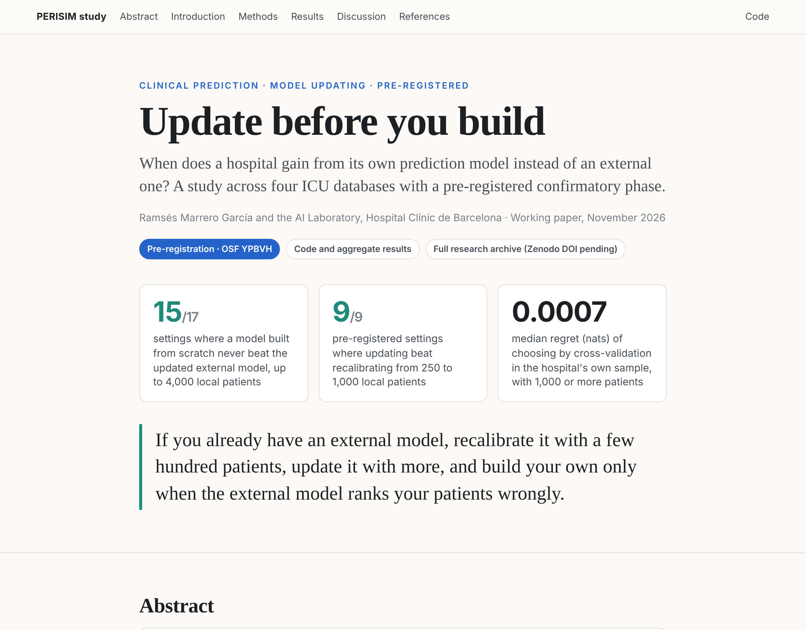
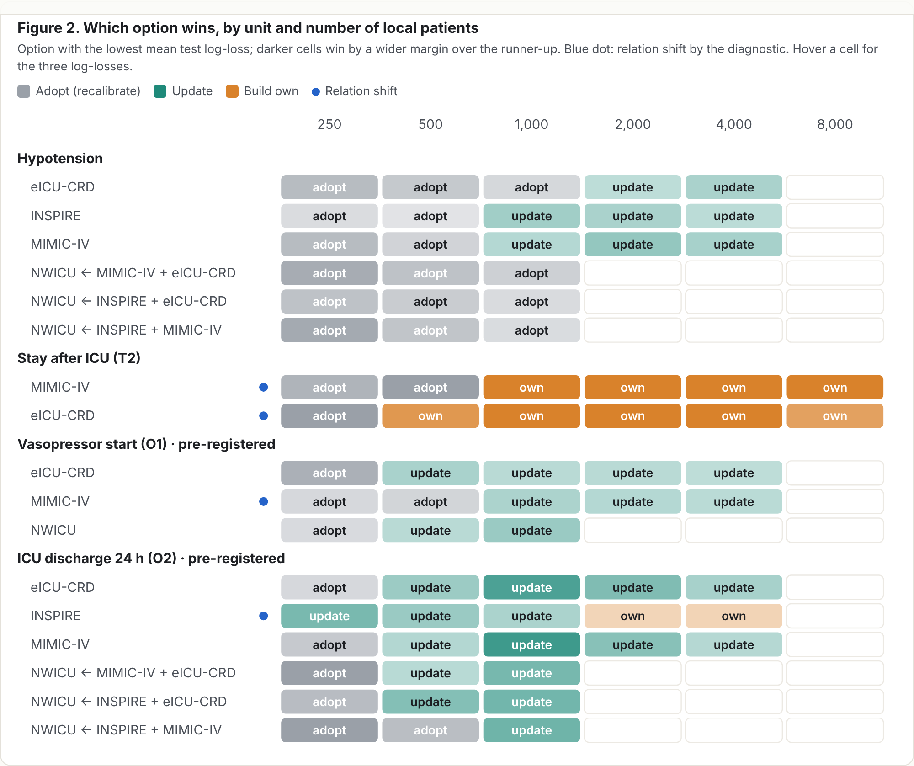
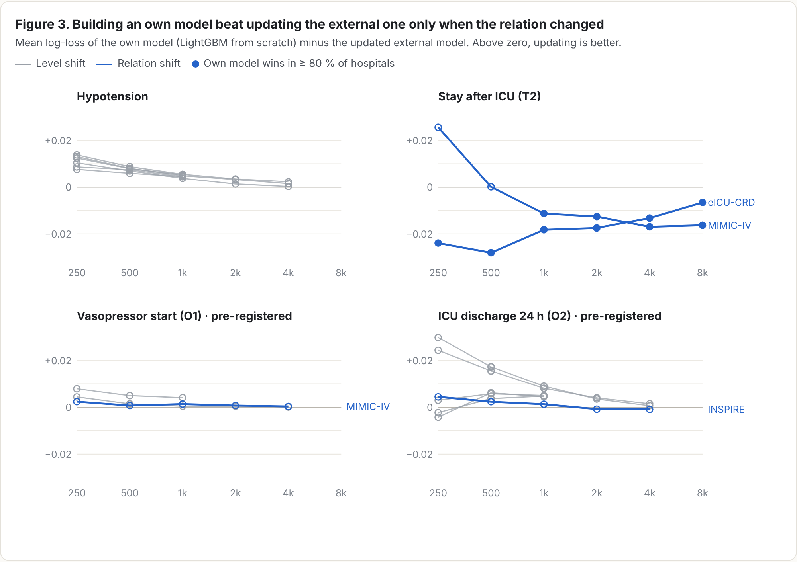

# Update before you build

**When does a hospital gain from its own prediction model instead of an external one?**
A study across four ICU databases (INSPIRE, MIMIC-IV, eICU-CRD, NWICU) with a pre-registered confirmatory phase.

**Read the article online:** https://ramsestein.github.io/perisim_study/

[](https://doi.org/10.17605/OSF.IO/YPBVH)
[](LICENSE)
[-9aa0a8)](https://github.com/ramsestein/perisim)

<p align="center"></p>

## The message

If a hospital already has an external model, it should **recalibrate it** with a few hundred patients, **update it** with local data once it has more, and **build its own** only when the external model ranks its patients wrongly.

| | |
|---|---|
| **15 of 17** settings | a model built from scratch never beat the updated external model, up to 4,000 local patients |
| **9 of 9** pre-registered settings | updating beat recalibrating from 250 to 1,000 local patients |
| **3** settings | building won by more than 0.002 nats, all with a change in the predictor–outcome relation |
| **0.0007 nats** | median regret of choosing by cross-validation in the hospital's own sample (1,000 or more patients) |

Pre-registered hypotheses (OSF [10.17605/OSF.IO/YPBVH](https://doi.org/10.17605/OSF.IO/YPBVH)): **H1 held** (the shift diagnosis anticipated the winning strategy in 5 of 5 evaluable units), **H2 did not hold** (cross-validation regret exceeded 0.002 nats in 3 of 9 units, at most 0.0045) and **H3 did not hold** (a fixed rule matched cross-validation in only 2 of 9 units).

<p align="center"></p>

<p align="center"></p>

## What is in this repository

This repository holds only what the article needs. The complete research archive (full code base, frozen artefacts, every decision and every aggregate result) is the [PERISIM repository](https://github.com/ramsestein/perisim), to be archived on Zenodo.

| Folder | Contents |
|---|---|
| [`docs/`](docs) | The web version of the article (GitHub Pages): `index.html`, interactive figures in `assets/charts.js`, data in `data/study.json`, static images in `img/` |
| [`results/`](results) | Aggregate results behind every number of the article: [`confirmatory/`](results/confirmatory) (pre-registered phase, with the first run kept in `first_run_deviation/`) and [`exploratory/`](results/exploratory) (hypotension and T2) |
| [`analysis/`](analysis) | The analysis scripts that produced those results |
| [`preregistration/`](preregistration) | The registered protocol and the relevant entries of the dated decision log |
| [`site/`](site) | `build_data.py`, which rebuilds `docs/data/study.json` from `results/` |
| [`tools/`](tools) | The public-safety check run before every commit |

## Reproduce

Figures and numbers of the web version come from the aggregates in this repository:

```bash
python site/build_data.py                  # results/ -> docs/data/study.json (standard library only)
python -m http.server -d docs 8000         # then open http://localhost:8000
python tools/check_public_safety.py --all  # no secrets, no patient-level data, no cells under 10
```

The scripts in `analysis/` regenerate `results/` from the four databases. They run on top of the full PERISIM code base (packages `hypo`, `perisim` and the frozen T2 code), which is in the full archive; see [`analysis/README.md`](analysis/README.md).

## Data

The four databases are credentialed PhysioNet resources and are **not redistributed**: INSPIRE (Lim et al., 2024), MIMIC-IV (Johnson et al., 2023), eICU-CRD (Pollard et al., 2018) and NWICU (Moukheiber et al., 2024). This repository contains aggregate results only, with no cell under 10 patients.

## Cite

See [`CITATION.cff`](CITATION.cff). Related: RECAL, the recalibration framework this study tests (Marrero García, 2026, SSRN, https://doi.org/10.2139/ssrn.7382597).

## Licence

MIT. Ramsés Marrero García and the AI Laboratory, Hospital Clínic de Barcelona.
