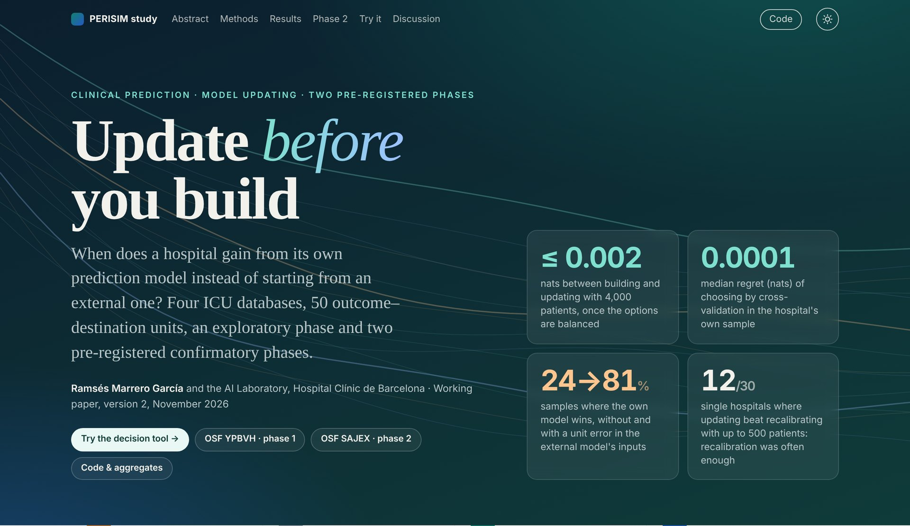
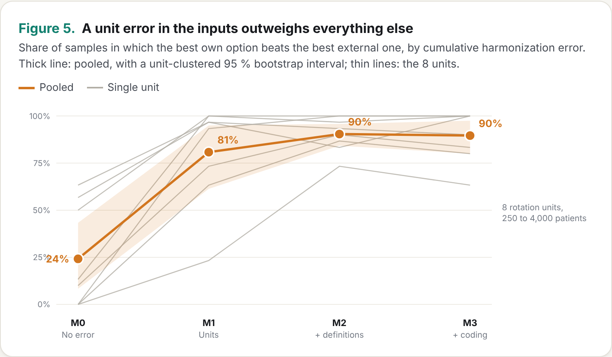
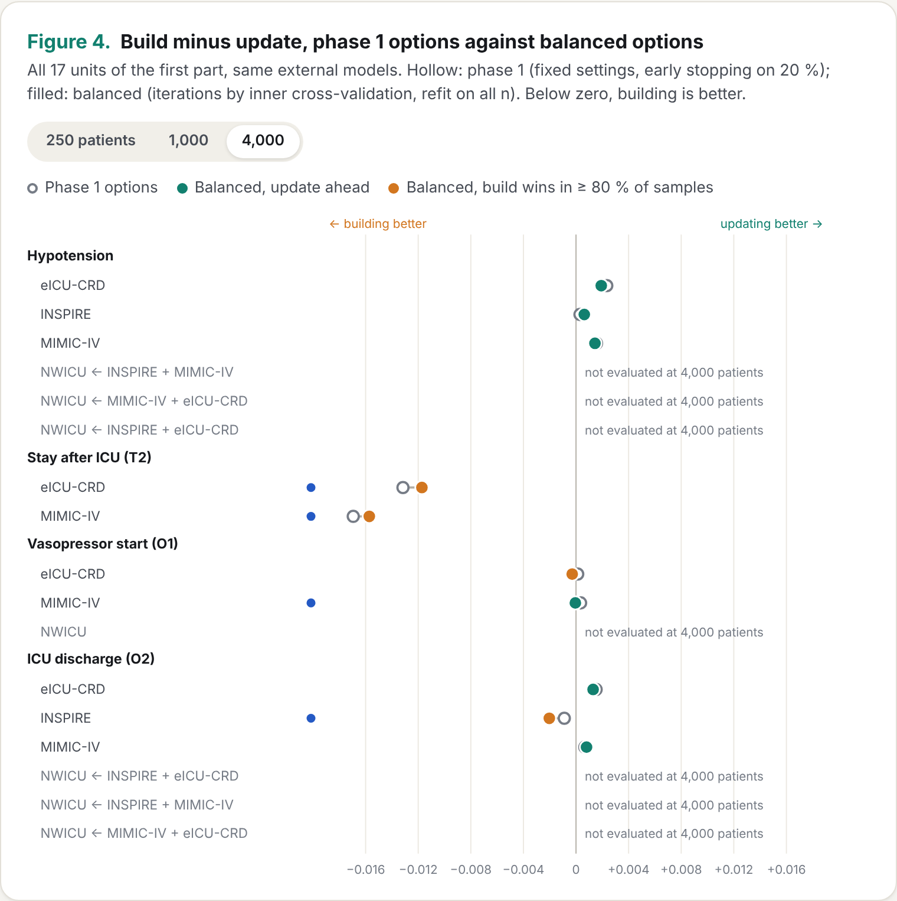
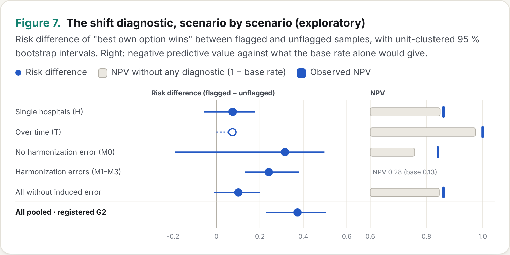

# Update before you build

**When does a hospital gain from its own prediction model instead of starting from an external one?**
Four ICU databases (INSPIRE, MIMIC-IV, eICU-CRD, NWICU), an exploratory phase and two pre-registered confirmatory phases.

**Read the article online:** https://ramsestein.github.io/perisim_study/ · **Try the tool:** [What should I do with my external model?](https://ramsestein.github.io/perisim_study/#tool)

[](https://doi.org/10.17605/OSF.IO/YPBVH)
[](https://doi.org/10.17605/OSF.IO/SAJEX)
[](LICENSE)
[-9aa0a8)](https://github.com/ramsestein/perisim)

<p align="center"></p>

## The message

1. **Check the inputs.** A unit, definition or coding error in what the external model receives outweighed everything else. Fix the mapping, then choose again; build only if the input cannot be corrected.
2. **Recalibrate** the external model with a few hundred patients. In single hospitals with up to 500 patients this was often enough.
3. **Update** it with local data once you have more labels. With balanced options, building came within 0.002 nats of updating only near 4,000 patients.
4. **Choose by patient-grouped cross-validation** in your own sample. The calibration slope and the expected AUROC did not tell when to build.

| | |
|---|---|
| **4 of 17** units | where building beat updating once the options were balanced (exploratory re-run): both T2 destinations (relation shift) and 2 rotation units with 4,000 patients, by ≤ 0.002 nats; none of the 7 NWICU units |
| **15 of 17** units | with unbalanced options (exploratory phase and phase 1), the own model never beat the updated external one |
| **12 of 30** single hospitals | updating beat recalibrating with up to 500 patients |
| **24 % → 81 %** | samples in which the best own option wins, without and with a unit error in the external model's inputs |
| **0.0001 nats** | median regret of choosing by cross-validation with 1,000 or more patients (phase 2, G4) |

**Phase 1** (OSF [YPBVH](https://doi.org/10.17605/OSF.IO/YPBVH)): H1 held as registered; H2 (cross-validation regret ≤ 0.002 nats in every unit) and H3 (a fixed rule matches cross-validation) did not.
**Phase 2** (OSF [SAJEX](https://doi.org/10.17605/OSF.IO/SAJEX)): G1–G4 held. Read with their strength in mind: G1 (single hospitals up to 500 patients, 3 temporal units) had little room to fail; G2 is driven by the induced harmonization errors (without them the risk difference is 0.10, 95 % CI −0.01 to 0.20); G3 is expected by construction and measures the size; G4 is a less demanding re-test of H2, registered after H2 failed.

<p align="center"></p>
<p align="center"></p>
<p align="center"></p>

## What is in this repository

This repository holds only what the article needs. The complete research archive (full code base, frozen artefacts, every decision and every aggregate result) is the [PERISIM repository](https://github.com/ramsestein/perisim), to be archived on Zenodo.

| Folder | Contents |
|---|---|
| [`docs/`](docs) | The web version of the article (GitHub Pages): `index.html`; figures in `assets/charts.js` (exploratory and phase 1) and `assets/phase2.js`; page behaviour in `assets/site.js`; data in `data/study.json`; static images in `img/` |
| [`results/`](results) | Aggregate results behind every number: [`exploratory/`](results/exploratory), [`confirmatory/`](results/confirmatory) (phase 1, with the first run in `first_run_deviation/`), [`confirmatory_phase2/`](results/confirmatory_phase2) (phase 2 and the exploratory diagnostic-by-scenario analysis) and [`sensitivity/`](results/sensitivity) (exploratory: balanced options for NWICU and T2, wins with a minimum margin) |
| [`analysis/`](analysis) | The analysis scripts that produced those results |
| [`preregistration/`](preregistration) | The two registered protocols and the relevant entries of the dated decision log |
| [`site/`](site) | `build_data.py`, which rebuilds `docs/data/study.json` from `results/` |
| [`tools/`](tools) | The public-safety check run before every commit |

## Reproduce

```bash
python site/build_data.py                    # results/ -> docs/data/study.json (standard library only)
python analysis/phase2_g2_by_scenario.py     # exploratory diagnostic accuracy by scenario (numpy only)
python -m http.server -d docs 8000           # then open http://localhost:8000
python tools/check_public_safety.py --all    # no secrets, no patient-level data, no cells under 10
```

The other scripts in `analysis/` regenerate `results/` from the four databases. They run on top of the full PERISIM code base (packages `hypo`, `perisim` and the frozen T2 code), which is in the full archive; see [`analysis/README.md`](analysis/README.md).

## Data

The four databases are credentialed PhysioNet resources and are **not redistributed**: INSPIRE (Lim et al., 2024), MIMIC-IV (Johnson et al., 2023), eICU-CRD (Pollard et al., 2018) and NWICU (Moukheiber et al., 2024). This repository contains aggregate results only, with no cell under 10 patients.

## Related

- RECAL, the recalibration framework this study tests (Marrero García, 2026, SSRN, https://doi.org/10.2139/ssrn.7382597).
- Patient-retrieval adaptation (kNN with a learned metric, and PRAM) is analysed separately in [perisim_knn_nca](https://github.com/ramsestein/perisim_knn_nca).

## Cite

See [`CITATION.cff`](CITATION.cff).

## Licence

MIT. Ramsés Marrero García and the AI Laboratory, Hospital Clínic de Barcelona.
